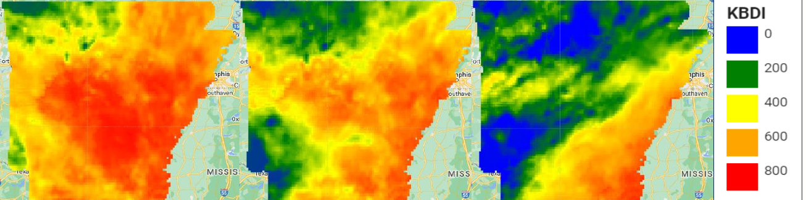

# Keetch-Byram Drought Index (KBDI) for Arkansas — Google Earth Engine

Daily, gridded **Keetch-Byram Drought Index (KBDI)** calculated in **Google Earth Engine (JavaScript)** from PRISM climate data, then aggregated to monthly county averages for all 75 Arkansas counties.

This code was written for my M.S. thesis in Geography at the University of Arkansas:
**[Fire Potential in Arkansas through the Lens of the Keetch-Byram Drought Index](https://scholarworks.uark.edu/etd/5275)** (2024).

*Daily KBDI across Arkansas on October 1, 15, and 30, 2023 (0 = no drought, 800 = maximum drought).*

---

## What is KBDI?

The Keetch-Byram Drought Index estimates soil moisture deficit on a scale of 0 (saturated) to 800 (maximum drought), using daily maximum temperature, daily precipitation, and mean annual precipitation. It is widely used in the U.S. to assess fire potential.

## What the script does

1. **Loads inputs** — PRISM daily climate data (`OREGONSTATE/PRISM/AN81d`: precipitation and maximum temperature), PRISM 1991–2020 normals (`OREGONSTATE/PRISM/Norm91m`) for mean annual precipitation, and TIGER/2018 state and county boundaries.
2. **Calculates KBDI daily** — iterates over each day with `ImageCollection.iterate()`, carrying the previous day's KBDI and precipitation forward to apply the standard KBDI rules (the 0.2-inch net-rainfall threshold for consecutive rain days, and the daily drought factor based on temperature and mean annual rainfall). Units are converted from metric to inches and °F.
3. **Builds monthly averages** — averages the daily KBDI images for the month at PRISM's ~4 km resolution.
4. **Aggregates to counties** — reduces the monthly mean to each county with `reduceRegions()`.
5. **Exports**
   - a CSV of mean monthly KBDI per county to Google Drive, and
   - the final day's KBDI image to an Earth Engine asset, which becomes the starting point for the next month's run.

## How to run it

Earth Engine can't iterate over a long time series in one request, so the index is calculated **one month at a time** and each month's last image is chained into the next:

1. Open the [Earth Engine Code Editor](https://code.earthengine.google.com/) (a free account is required) and paste in `kbdi_arkansas.js`.
2. Set `start_date` and `end_date` to the first month (for example, `2012-07-01` to `2012-08-01`).
3. **First run:** leave the zero-value `first` image in place. The index needs a spin-up period to settle to realistic values; the thesis used four years.
4. Run the script, then start both export tasks in the **Tasks** tab.
5. **Later runs:** import the previous month's exported asset as `image`, switch to the "LATER RUNS" block, advance the dates, rename the exports, and run again.
6. For months shorter than 31 days, comment out the unused `list` lines in the DAILY KBDI IMAGES section.

To use a different state, change `state_name` and `state_fp` (the state FIPS code).

## Results

[Mean monthly KBDI by Arkansas county, 2012–2023](img/kbdi_avg_by_county.jpg)
*Mean monthly KBDI by county, 2012–2023.*

In the thesis, monthly county KBDI was compared with 2012–2024 VIIRS 375 m active fire detections. KBDI was significantly correlated with fire occurrence during peak fire season in the agricultural counties of eastern Arkansas, but not in the forested west and north, where most fires are human-caused.

[Counties with a significant VIIRS–KBDI correlation](img/viirs_kbdi_correlation.jpg)
*Counties with a significant correlation between fire occurrence and KBDI (r > 0.5, 90% confidence) during peak fire season.*

## Data sources

- [PRISM daily climate data](https://developers.google.com/earth-engine/datasets/catalog/OREGONSTATE_PRISM_AN81d), PRISM Climate Group, Oregon State University
- [PRISM 30-year normals](https://developers.google.com/earth-engine/datasets/catalog/OREGONSTATE_PRISM_Norm91m)
- [TIGER/2018 state and county boundaries](https://developers.google.com/earth-engine/datasets/catalog/TIGER_2018_Counties), U.S. Census Bureau
- [VIIRS 375 m active fire product](https://firms.modaps.eosdis.nasa.gov/), NASA FIRMS (used in the thesis analysis, not in this script)

## Citation

Steward, C. (2024). *Fire Potential in Arkansas through the Lens of the Keetch-Byram Drought Index.* Graduate Theses and Dissertations, University of Arkansas. https://scholarworks.uark.edu/etd/5275

## License

MIT — see [LICENSE](LICENSE).
